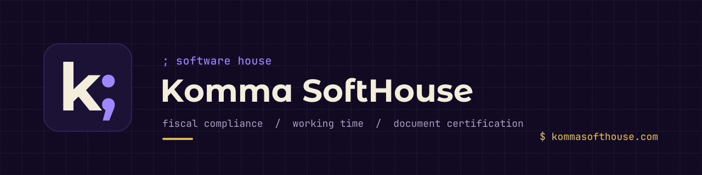

<picture>
  <source media="(prefers-color-scheme: dark)" srcset="./assets/banner-dark.svg">
  <source media="(prefers-color-scheme: light)" srcset="./assets/banner-light.svg">
  
</picture>

<br>

Software for the rules Spanish businesses actually have to follow: chained
invoice records for the tax agencies, working-time records an inspector can
read, and documents whose integrity anyone can check. Built on Laravel and
Filament, shipped as plugins, SaaS and native apps.

`$` [kommasofthouse.com](https://kommasofthouse.com) &nbsp;&nbsp;
`$` [info@kommasofthouse.com](mailto:info@kommasofthouse.com)

<br>

## `;` products

| | What it solves | |
| --- | --- | --- |
| **filament-verifactu** | Spanish fiscal compliance for any Laravel + Filament app that invoices: AEAT, TicketBAI, Navarra and FACe in one plugin | [→ docs](https://github.com/komma-softhouse/filament-verifactu-docs) |
| **Kontime** | Working-time records under RDL 8/2019, with entries that cannot be edited after the fact | [→ kontime.kommasofthouse.com](https://kontime.kommasofthouse.com) |
| **Komma Stamps** | Proof of existence and integrity for any document, anchored on Arbitrum One | [→ stamps.kommasofthouse.com](https://stamps.kommasofthouse.com) |

<br>

### filament-verifactu

The fiscal engine for any Laravel + Filament application that invoices in
Spain. Four regimes, one plugin, one gate.

| Regime | What ships |
| --- | --- |
| **AEAT** · common territory | VERI\*FACTU and non-Verifactu chained records, hash chain, XAdES signing, tributary QR, queued submission with flow control, homologation battery |
| **TicketBAI** · Araba, Bizkaia, Gipuzkoa | Signature-chained registration, cancellation, corrective invoices, Zuzendu, per-territory endpoints, and both chapters of Bizkaia's LROE (issued and received) |
| **Navarra** | Full document lifecycle and the foral report drafts (F-69, F-50, 349, 715, 759); NaTicket plugs in the day the Orden Foral is published |
| **Public and B2B e-invoicing** | Facturae 3.2.2, FACe and FACeB2B with the complete receiver-side lifecycle |

On top of the fiscal core:

→ the whole document flow: quotes, invoices, credit notes, SAT repair orders<br>
→ the received side of the ledger: supplier invoices and expenses, OCR capture, attachment preview<br>
→ A4 and thermal printing with a live template designer, plus a Print Agent for cloud tills<br>
→ an on-prem API sidecar for POS and ERP terminals<br>
→ tax drafts that read both sides: 303, 347, 349, withholding and a corporate-tax estimate

230 tests. Six languages. `->expenses()`, `->face()`, `->ocr()` and every
other surface is an explicit opt-in.

The source is private. Documentation, issues and discussions live in
[filament-verifactu-docs](https://github.com/komma-softhouse/filament-verifactu-docs);
lifetime licence holders are invited to the source repository and report there.

`$` [documentation](https://github.com/komma-softhouse/filament-verifactu-docs) &nbsp;&nbsp;
`$` [issues](https://github.com/komma-softhouse/filament-verifactu-docs/issues) &nbsp;&nbsp;
`$` [discussions](https://github.com/komma-softhouse/filament-verifactu-docs/discussions)

### Kontime

Employee time tracking built for Spain's RDL 8/2019. Clock in from an NFC
kiosk, a QR code, the web or WhatsApp; shift records stay locked once
written, and reports export ready for a labour inspection.

### Komma Stamps

A document's hash anchored on Arbitrum One (contract v2) and a certificate
anyone can verify, without trusting us. Web, desktop watched folders and an
Android app.

<br>

## `;` open-source engines

The fiscal plugin depends on these packages through Composer, so they are
open by design and usable on their own.

| Package | Scope | |
| --- | --- | --- |
| **verifactu-engine** | AEAT VERI\*FACTU records, hash chain and SOAP client | [→ repo](https://github.com/komma-softhouse/verifactu-engine) |
| **tbai-engine** | TicketBAI for the three Basque territories, Zuzendu, and Bizkaia's LROE (Batuz) with issued and received chapters | [→ repo](https://github.com/komma-softhouse/tbai-engine) |
| **facturae-engine** | Facturae 3.2.2, XAdES, FACe and FACeB2B | [→ repo](https://github.com/komma-softhouse/facturae-engine) |

```bash
composer require komma-softhouse/verifactu-engine
```

<br>

## `;` apps

Native apps are distributed from public release repositories. Each one
checks its own repository for updates.

| App | Platforms | |
| --- | --- | --- |
| **Komma POS Beauty** | Windows, macOS | [→ releases](https://github.com/komma-softhouse/komma-pos-beauty-releases) |
| **Komma POS Retail** | Windows, macOS | [→ releases](https://github.com/komma-softhouse/komma-pos-retail-releases) |
| **TicketRápido** | Windows, macOS | [→ releases](https://github.com/komma-softhouse/komma-ticket-rapido-releases) |
| **TicketRápido** | Android | [→ releases](https://github.com/komma-softhouse/komma-ticket-rapido-android-releases) |
| **Komma Stamps** | Windows, macOS | [→ releases](https://github.com/komma-softhouse/komma-stamps-releases) |
| **Komma Stamps** | Android | [→ releases](https://github.com/komma-softhouse/komma-stamps-android-releases) |

<br>

## `;` for developers

→ [skeleton-plugin](https://github.com/komma-softhouse/skeleton-plugin): the template every Komma Filament 5 plugin starts from<br>
→ standards implemented: VERI\*FACTU (RD 1007/2023), TicketBAI, Batuz LROE 140/240, Hacienda Foral de Navarra, Facturae 3.2.2 with FACe and FACeB2B, Registro de Jornada (RDL 8/2019)<br>
→ stack: Laravel 13, PHP 8.4+, Filament v5, Livewire v4, Tailwind CSS v4

<br>

## `;` contact

`$` [kommasofthouse.com](https://kommasofthouse.com) &nbsp;&nbsp;
`$` [linkedin](https://www.linkedin.com/company/komma-softhouse) &nbsp;&nbsp;
`$` [instagram](https://www.instagram.com/kommasofthouse) &nbsp;&nbsp;
`$` [info@kommasofthouse.com](mailto:info@kommasofthouse.com)

<br>

<sub>© Komma SoftHouse</sub>