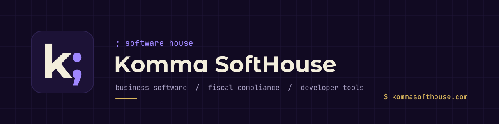

<picture>
  <source media="(prefers-color-scheme: dark)" srcset="./assets/banner-dark.svg">
  <source media="(prefers-color-scheme: light)" srcset="./assets/banner-light.svg">
  
</picture>

<br>

Software that businesses sell with: online products, tills and handhelds that
keep working offline, and the fiscal layer underneath them. Plus the Filament
plugins and PHP engines we build it all on, for teams who want them in their
own apps.

`$` [kommasofthouse.com](https://kommasofthouse.com) &nbsp;&nbsp;
`$` [info@kommasofthouse.com](mailto:info@kommasofthouse.com)

<br>

## `;` products

| | What it does | |
| --- | --- | --- |
| **Pyme** | Invoices, tickets and quotes with VERI\*FACTU built in; sales, purchases, stock and accounting in one place | [→ pyme.kommasofthouse.com](https://pyme.kommasofthouse.com) |
| **Komma ERP** | Every store in one system: the till sells, the handheld counts stock, head office sees each store's figures | [→ kommaerp.kommasofthouse.com](https://kommaerp.kommasofthouse.com) · [demo](https://kommaerp-demo.kommasofthouse.com) |
| **Komma POS Retail** | The till of a store, paid once: barcodes, stock, returns, gift vouchers, cash closing, Verifactu; works offline | [→ posretail.kommasofthouse.com](https://posretail.kommasofthouse.com) |
| **TicketRápido** | Sell and print tickets at the box office, validate them with a phone at the door; Verifactu included | [→ product page](https://kommasofthouse.com/contratar/ticket-rapido) |
| **Kontime** | Working-time records under RDL 8/2019: clock in from a phone, a QR code or an NFC kiosk; records an inspector can read | [→ kontime.kommasofthouse.com](https://kontime.kommasofthouse.com) |
| **Komma Stamps** | Proof that a document existed, when, and whose it was: its SHA-256 hash anchored on Arbitrum One; the file never leaves your device | [→ stamps.kommasofthouse.com](https://stamps.kommasofthouse.com) |
| **Komma Blackbox** | Your website as an attacker sees it: what is exposed, ordered by risk, with how to fix it | [→ blackbox.kommasofthouse.com](https://blackbox.kommasofthouse.com) |

<br>

## `;` apps

Native apps are distributed from public release repositories, and each one
updates itself from its own repository.

| App | Part of | |
| --- | --- | --- |
| **Komma TPV** | Komma ERP · store till | [→ releases](https://github.com/komma-softhouse/komma-tpv-releases) |
| **Komma PDA** | Komma ERP · warehouse and store handheld | [→ releases](https://github.com/komma-softhouse/komma-pda-releases) |
| **Komma POS Retail** | Desktop point of sale | [→ releases](https://github.com/komma-softhouse/komma-pos-retail-releases) |
| **Komma POS Beauty** | Desktop point of sale for salons | [→ releases](https://github.com/komma-softhouse/komma-pos-beauty-releases) |
| **TicketRápido** | Box office · desktop | [→ releases](https://github.com/komma-softhouse/komma-ticket-rapido-releases) |
| **TicketRápido** | Box office and door control · Android | [→ releases](https://github.com/komma-softhouse/komma-ticket-rapido-android-releases) |
| **Kontime** | Employee app · Android | [→ releases](https://github.com/komma-softhouse/kontime-app-android-releases) |
| **Kontime Kiosk** | Shared clock-in kiosk with NFC · Android | [→ releases](https://github.com/komma-softhouse/kontime-kiosk-android-releases) |
| **Pyme** | Invoice capture by photo · Android | [→ releases](https://github.com/komma-softhouse/pyme-app-android-releases) |
| **Komma Stamps** | Desktop with watched folders | [→ releases](https://github.com/komma-softhouse/komma-stamps-releases) |
| **Komma Stamps** | Android | [→ releases](https://github.com/komma-softhouse/komma-stamps-android-releases) |
| **Komma Signage Player** | Digital signage player · Android TV and Fire TV | [→ releases](https://github.com/komma-softhouse/komma-signage-player-releases) |

<br>

## `;` filament plugins

Commercial plugins for Filament v5. Sources are private; documentation,
issues and discussions live in each public docs repository.

| Plugin | What it does | |
| --- | --- | --- |
| **filament-verifactu** | Spanish fiscal compliance: AEAT VERI\*FACTU, TicketBAI and Bizkaia LROE, Navarra, Facturae with FACe and FACeB2B | [→ docs](https://github.com/komma-softhouse/filament-verifactu-docs) |
| **Eesti Billing** | Estonian invoicing for Filament | [→ docs](https://github.com/komma-softhouse/filament-eesti-billing-docs) |
| **Multi-Tenancy** | Database-per-tenant multi-tenancy on stancl/tenancy 3 | [→ docs](https://github.com/komma-softhouse/filament-tenancy-docs) |
| **Filament Navigator** | Database-driven sidebar and topbar, run from the panel itself | [→ docs](https://github.com/komma-softhouse/filament-navigator-docs) |
| **BTCPay** | Crypto payments through BTCPay Server | [→ docs](https://github.com/komma-softhouse/filament-btcpay-docs) |

### filament-verifactu in detail

| Regime | What ships |
| --- | --- |
| **AEAT** · common territory | VERI\*FACTU and non-Verifactu chained records, hash chain, XAdES signing, tributary QR, queued submission with flow control, homologation battery |
| **TicketBAI** · Araba, Bizkaia, Gipuzkoa | Signature-chained registration, cancellation, corrective invoices, Zuzendu, per-territory endpoints, and both chapters of Bizkaia's LROE (issued and received) |
| **Navarra** | Full document lifecycle and the foral report drafts (F-69, F-50, 349, 715, 759); NaTicket plugs in the day the Orden Foral is published |
| **Public and B2B e-invoicing** | Facturae 3.2.2, FACe and FACeB2B with the complete receiver-side lifecycle |

On top of the fiscal core:

→ the whole document flow: quotes, invoices, credit notes, SAT repair orders<br>
→ the received side of the ledger: supplier invoices and expenses, OCR capture, attachment preview<br>
→ A4 and thermal printing with a live template designer, plus a Print Agent for cloud tills<br>
→ an on-prem API sidecar for POS and ERP terminals<br>
→ tax drafts that read both sides: 303, 347, 349, withholding and a corporate-tax estimate

230 tests. Six languages. `->expenses()`, `->face()`, `->ocr()` and every
other surface is an explicit opt-in. Lifetime licence holders are invited to
the source repository and report there.

<br>

## `;` open-source engines

The plugins depend on these packages through Composer, so they are open by
design and usable on their own in any PHP application.

| Package | Scope | |
| --- | --- | --- |
| **verifactu-engine** | AEAT VERI\*FACTU records, hash chain and SOAP client | [→ repo](https://github.com/komma-softhouse/verifactu-engine) |
| **tbai-engine** | TicketBAI for the three Basque territories, Zuzendu, and Bizkaia's LROE (Batuz) with issued and received chapters | [→ repo](https://github.com/komma-softhouse/tbai-engine) |
| **facturae-engine** | Facturae 3.2.2, XAdES, FACe and FACeB2B | [→ repo](https://github.com/komma-softhouse/facturae-engine) |
| **asice-engine** | ASiC-E containers with XAdES signatures for Estonian eID: ID-kaart via Web eID, Smart-ID and Mobile-ID, with OCSP and time-stamp | [→ repo](https://github.com/komma-softhouse/asice-engine) |

```bash
composer require komma-softhouse/verifactu-engine
```

<br>

## `;` for developers

→ [skeleton-plugin](https://github.com/komma-softhouse/skeleton-plugin): the template every Komma Filament 5 plugin starts from<br>
→ standards implemented: VERI\*FACTU (RD 1007/2023), TicketBAI, Batuz LROE 140/240, Hacienda Foral de Navarra, Facturae 3.2.2 with FACe and FACeB2B, ASiC-E, Registro de Jornada (RDL 8/2019)<br>
→ stack: Laravel 13, PHP 8.4+, Filament v5, Livewire v4, Tailwind CSS v4, NativePHP

<br>

## `;` contact

`$` [kommasofthouse.com](https://kommasofthouse.com) &nbsp;&nbsp;
`$` [linkedin](https://www.linkedin.com/company/komma-softhouse) &nbsp;&nbsp;
`$` [instagram](https://www.instagram.com/kommasofthouse) &nbsp;&nbsp;
`$` [info@kommasofthouse.com](mailto:info@kommasofthouse.com)

<br>

<sub>© Komma SoftHouse</sub>